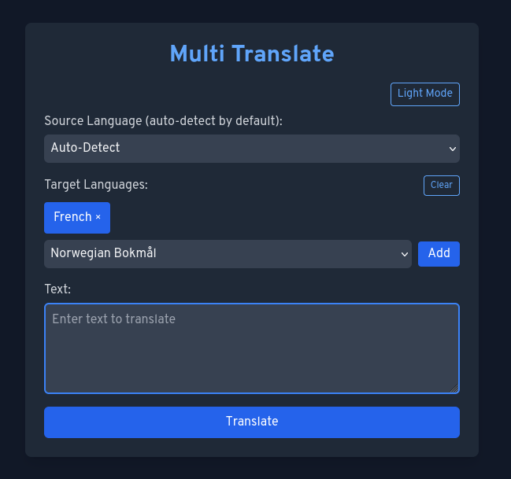

# Multi Translate

A simple client-side translation app built with Vue 3 and Tailwind CSS. It uses the [DeepL](https://www.deepl.com/) API for translations. Direct calls to
DeepL from the browser are blocked by CORS, so a small Node.js proxy server is
included. The source language is set to **Auto‑Detect** by default so you can
paste any text without choosing a language first.



## Setup

### Standard Installation

1. Create a `.env` file (or export variables in your shell) to provide your
   DeepL API configuration:

   ```bash
   echo "API_KEY=your_key" > .env
   echo "API_URL=https://api-free.deepl.com/v2" >> .env
   ```

2. Install dependencies and start the server:
   ```bash
   npm install
   npm start
   ```
   The server listens on port `3000` by default and forwards requests to DeepL.

3. Open `http://localhost:3000` in your browser.

### NixOS Installation

#### Option 1: Using Nix Flakes (Recommended)

1. Add the flake to your NixOS configuration:

   ```nix
   # In your flake.nix
   {
     inputs = {
       nixpkgs.url = "github:NixOS/nixpkgs/nixos-unstable";
       multi-translate.url = "path:/path/to/multi-translate";
       # or from GitHub: multi-translate.url = "github:yourusername/multi-translate";
     };

     outputs = { self, nixpkgs, multi-translate, ... }: {
       nixosConfigurations.yourhost = nixpkgs.lib.nixosSystem {
         modules = [
           multi-translate.nixosModules.default
           {
             services.multi-translate = {
               enable = true;
               apiKey = "your-deepl-api-key";
               apiUrl = "https://api-free.deepl.com/v2";
               port = 3000;
             };
           }
         ];
       };
     };
   }
   ```

2. Rebuild your system:
   ```bash
   sudo nixos-rebuild switch --flake .#yourhost
   ```

#### Option 2: Traditional NixOS Module

1. Copy this repository to `/etc/nixos/modules/multi-translate/`

2. Add to your `/etc/nixos/configuration.nix`:

   ```nix
   { config, pkgs, ... }:
   {
     imports = [
       ./modules/multi-translate/module.nix
     ];

     services.multi-translate = {
       enable = true;
       apiKey = "your-deepl-api-key";
       apiUrl = "https://api-free.deepl.com/v2";
       port = 3000;
     };

     # Optional: Open firewall for the service
     networking.firewall.allowedTCPPorts = [ 3000 ];
   }
   ```

3. Rebuild your system:
   ```bash
   sudo nixos-rebuild switch
   ```

#### Development Environment

Enter a development shell with all dependencies:

```bash
nix-shell
# or with flakes:
nix develop
```

This provides Node.js, npm, nodemon, and other development tools.

#### Building the Package

Build the package directly:

```bash
# With flakes:
nix build

# Without flakes:
nix-build default.nix
```

Run the built package:
```bash
./result/bin/multi-translate
```

### Configuration Options

The NixOS module supports the following options:

- `services.multi-translate.enable` - Enable the service (default: false)
- `services.multi-translate.port` - Port to listen on (default: 3000)
- `services.multi-translate.apiKey` - DeepL API key (required)
- `services.multi-translate.apiUrl` - DeepL API URL (default: https://api-free.deepl.com/v2)
- `services.multi-translate.user` - User to run as (default: multi-translate)
- `services.multi-translate.group` - Group to run as (default: multi-translate)

## Security Notes

The `.env` file is ignored by git so that your API key stays out of version control. Keep the file private if you include sensitive credentials.

For NixOS deployments, consider using `agenix` or `sops-nix` to manage secrets instead of hardcoding the API key in your configuration.
